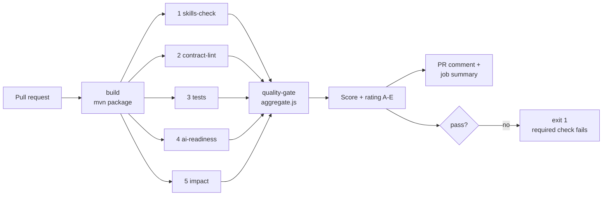

# agent-quality-gate

**Your agent passed the build. Did it pass the gate?**

A CI quality gate for API changes, modeled on the Java gates you already know (SonarQube, OWASP dependency-check, linters) and built entirely on the **Postman CLI**. Every step is one CLI command you can run live.

## The problem

Sonar analyzes your code. Nothing in that stack analyzes the API *contract*, or who depends on it. A coding agent can rename a response field, update the unit tests to match, keep the build green, and still break every consumer. The gate adds the missing checks, and because it runs in CI, outside the agent, the agent cannot skip it.

## The pipeline



## The 5 steps

Each script runs one Postman CLI command and writes `gate-results/<step>.json` (`pass | warn | fail | not_available`, score 0-100). A step never fails the job: the aggregate job decides.

| # | Step | Sonar analogy | Command | What it checks |
|---|------|---------------|---------|----------------|
| 1 | `skills-check` | dependency-check | `postman skills status --json` | Postman skills committed in the repo are current. An outdated skill is a vulnerable library. Works around a CLI bug, see Known limits |
| 2 | `contract-lint` | linter | `postman spec lint contract/openapi.yaml -o json` | OpenAPI contract against Postman governance rules |
| 3 | `tests` | unit tests + coverage | `mvn test` + `postman collection run … --use-mock …` | JUnit, then the Postman collection (the consumers' expectation) replayed against a mock **regenerated from the current contract** |
| 4 | `ai-readiness` | maintainability | `postman spec ai-readiness contract/openapi.yaml -o json` | How well an agent can discover, understand and call the API |
| 5 | `impact` | none: this is the point | `postman context-graph ask …` | Who consumes the API in the Context Graph, and does the contract diff look breaking |

Exact flags, output formats and what exists today: [docs/cli-inventory.md](docs/cli-inventory.md).

## Scoring model

Configured in [`quality-gate.yml`](quality-gate.yml).

- **Composite score**: weighted average. Weights: skills 10, lint 25, tests 25, AI readiness 20, impact 20.
- **Rating**: A ≥ 90, B ≥ 80, C ≥ 70, D ≥ 50, E < 50. The gate passes at **B or better**.
- **Hard blockers**, whatever the score: a lint error, a failing test, a breaking impact on a consumer.
- **`not_available` steps** are left out of the average (the other weights are re-normalized) and shown in grey in the report. They are never counted as a pass.

Example report: [scenarios/02-agent-breaking-change.md](scenarios/02-agent-breaking-change.md).

## Repository layout

| Path | Content |
|------|---------|
| `contract/openapi.yaml` | OpenAPI 3.1 contract of `appointments-service` (from `healthcare-org-app/healthcare-appointments`) |
| `src/` | Spring Boot 3 / Java 21 implementation of that contract (in-memory, written for this demo) |
| `postman/` | v3 collection with `pm.test` assertions, local mock, spec link (synced to a Postman workspace) |
| `gate/` | the 5 step scripts, `aggregate.js`, `run-all.sh`, shared helpers |
| `.github/workflows/quality-gate.yml` | the CI pipeline |
| `scenarios/` | the two demo scenarios |
| `docs/` | plugin inventory, CLI inventory, architecture |

## Quickstart

**Two layers, two tools.** The coding agent works through the **Postman plugin** (it calls the CLI under the hood). CI has no agent, so the gate scripts call the **Postman CLI** directly.

1. **Install the Postman plugin in your coding agent.** In Claude Code: `npx @postman/postman-plugin install` (or `/plugin`). Ask for Postman work in plain language; its hook routes the request to the `api-engineer` skill. How this repo was built through the plugin: [docs/plugin-inventory.md](docs/plugin-inventory.md).
2. **Fork** this repository.
3. **Set the secret** `POSTMAN_API_KEY` (Settings > Secrets and variables > Actions). Use the key of the Postman team that holds your Context Graph ingestion, otherwise step 5 is `not_available`.
4. *(optional)* Set the repository **variable** `IMPACT_API` to the API name as registered in the Context Graph (default: `appointments-service`).
5. **Bind your own workspace**: delete `.postman/resources.yaml` and run `postman workspace create --visibility personal`. Nothing else holds a workspace, API or mock ID; the workflow reads no ID.
6. **Run it locally**, from the repo root (needs Java 21, Maven, Node, `jq` and the Postman CLI 1.73.0, logged in):

   ```bash
   postman login --with-api-key "$POSTMAN_API_KEY"
   ./gate/run-all.sh                 # all five steps + report
   ./gate/02-contract-lint.sh        # or one step; same JSON as in CI
   ```

7. **Open a PR.** The workflow posts (and updates) one comment with the score, the rating and the table per step, writes the same report to the job summary, and exits non-zero when the gate fails. Mark the `quality-gate` job as a required check.

Required secrets and variables:

| Name | Kind | Used by |
|------|------|---------|
| `POSTMAN_API_KEY` | secret | login, cloud-backed steps |
| `IMPACT_API` | variable (optional) | step 5 |

No workspace ID, API ID or mock URL is needed in CI: the contract and the collection are local files, and the mock is generated on the runner.

## Run it live

```bash
./scripts/demo-api.sh      # builds with the Maven wrapper, starts the API, runs the Postman collection against it
./gate/run-all.sh          # the five gate steps and the report, locally
```

The two-agent demo (a coder agent pushes a change, the gate runs in CI, a reviewer agent reads the result and briefs the coder) is described in [docs/demo-runbook.md](docs/demo-runbook.md). Agents live in `.claude/agents/`, the loop is the `/demo-loop` command.

## Demo scenarios

| Scenario | Branch | Result |
|----------|--------|--------|
| [Safe change](scenarios/01-safe-change.md): optional field added to `Appointment` | `demo/safe-change` | rating **A**, passes |
| [Agent breaking change](scenarios/02-agent-breaking-change.md): response field renamed, request field made required, unit tests updated | `demo/agent-breaking-change` | fails on a failing collection run and a breaking impact (rating C, two blockers) |

## Known limits

Stated plainly, because a gate you cannot trust is worse than none.

- **`skills-check` works around a Postman CLI bug.** In CLI 1.73.0 and 1.75.0, `postman skills status` answers `foreign` as soon as `postman/skills` holds a `.py` file, and the skills ship two of them. The step checks a temporary copy without `.py` files and ignores those two. It checks the skills committed in the repo, not the version of the agent plugin (`claude plugin update postman`).
- **Impact depends on an LLM.** `context-graph ask` returns free text. The step asks for JSON only and retries an empty answer up to 3 times, but it can still miss a consumer. "Breaking" is a heuristic on the contract diff (removed or renamed property or path, changed `required:` list), not a real compatibility check.
- **Impact needs the Context Graph of the right team.** The graph must hold `appointments-service` (ingested from `healthcare-org-app/healthcare-appointments`), and `POSTMAN_API_KEY` must belong to that team.
- **Contract lint does not catch breaking changes.** No built-in governance rule flags a rename or a new required field.
- **Collection `baseUrl` is the local server** (`http://localhost:8080`), not the production server of the spec: the gate always redirects it to a generated mock.
- **Collection tests are state-dependent**: they assume the seeded appointment `2317` of a fresh app start.
- **The Java code is a reimplementation**, not the original Flask service: only the contract is shared with `healthcare-appointments`. Its documented side effects (Kafka events, audit events, peer enrichment on create) and authentication are not implemented.
- **Postman v3 format**: the collection is a folder of YAML files, not one `*.postman_collection.json`.
- **CI run not verified end to end yet**: the workflow structure is validated, but a real run needs the `POSTMAN_API_KEY` secret.

## Related topics

This repo reuses steps from topics #3, #5, #10 and #13 of the AI Content Matrix, and explains the *how* behind #18 (CI-gated governance). Topic #1 is the mod that will later display the gate results.
