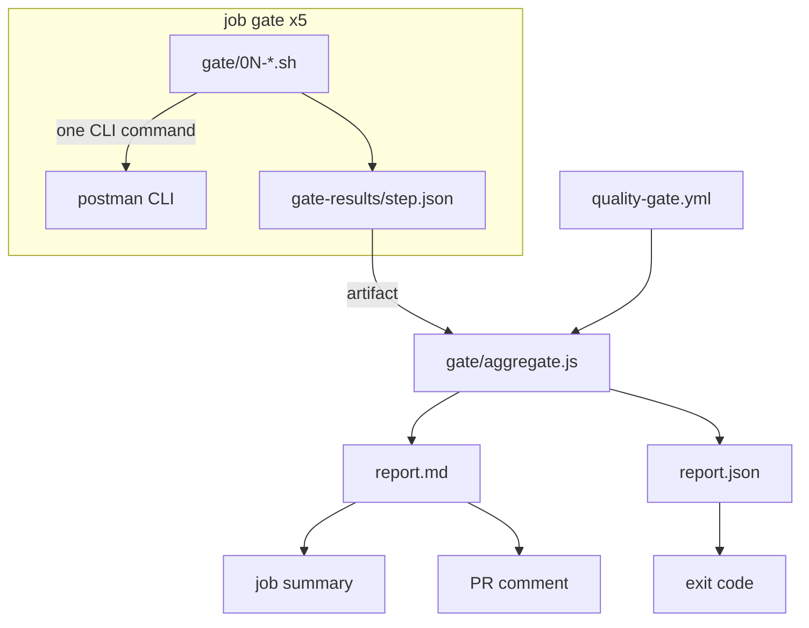

# Architecture

## Two layers, two tools

| Layer | Who runs it | Postman access |
|-------|-------------|----------------|
| Authoring | the coding agent, in Claude Code | the **Postman plugin**: a hook routes requests to `api-engineer`, which delegates to skills (bootstrap, documentation, testing, mocking) |
| Gate | GitHub Actions, no agent | the **Postman CLI**, called directly by `gate/*.sh` |

The gate lives outside the agent on purpose: an agent that can edit the code and the tests can also edit anything running next to it, but not a required CI check.

## Data flow



## Step result contract

```json
{ "step": "contract-lint", "status": "pass|warn|fail|not_available",
  "score": 0, "summary": "…", "details": [], "command": "postman …" }
```

`score` is `null` when the step is `not_available`. `details` is free-form; for `impact`, an item with `"breaking": true` is a hard blocker.

## Why the tests step catches what JUnit misses

`gate/03-tests.sh` generates a fresh mock from the **current** `contract/openapi.yaml` (`postman mock generate`), then replays the **committed** collection against it. The collection holds what consumers expect; the contract holds what the code now promises. If they diverge, assertions fail even when the agent updated every unit test.

## Decisions

- Scripts always exit 0; `aggregate.js` is the only place that decides. A crashed step shows up as `not_available`, never as a silent pass.
- `quality-gate.yml` is read by a 40-line parser in `aggregate.js`, so the repo needs no YAML dependency. Keep the file flat.
- Actions are pinned by commit SHA; the Postman CLI is pinned to 1.73.0, the version the inventory was verified on.
- Workspace, spec, collection and mock are synced to a Postman workspace in the devrel team (`postman workspace push`); the repo files remain the source for the gate.
