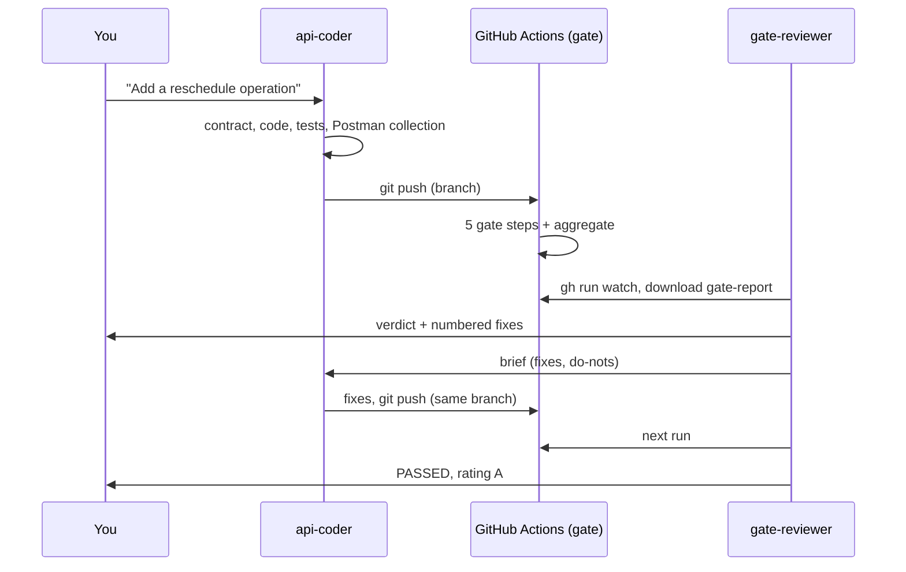

# Live demo runbook: two agents and the gate

**Story.** A Java, API-first project. The contract is the source of truth, the Postman objects (collection, mock, spec) live in the repo and in a workspace, and a quality gate in CI checks that the API stays good for agents. A coding agent changes the API, the gate judges it, a second agent reads the verdict and tells the coder what to fix, until the gate is green.



## Before the demo (5 minutes)

```bash
git switch main && git pull
postman login --with-api-key "$POSTMAN_API_KEY"   # same key as the repo secret
gh auth status                                    # gh must be logged in
./scripts/demo-api.sh                             # the API runs and honours the contract
./gate/run-all.sh                                 # baseline: rating A
```

Open in the Claude Code project (the agents are in `.claude/agents/`):

- `api-coder`: implements, runs the gate locally, pushes the branch.
- `gate-reviewer`: reads the CI result (read-only) and writes the fixes brief.

## Run it

One command drives the loop:

```
/demo-loop Add a reschedule operation: POST /api/appointments/{record_id}/reschedule with a body { starts_at (date-time, required), reason (optional) }. It moves the appointment to the new time and returns the appointment. 404 if it does not exist.
```

Or step by step: ask `api-coder` for the feature, then ask `gate-reviewer` for the verdict on the pushed branch and SHA, then pass the brief to `api-coder`.

## What to point at on screen

1. **The contract diff** the coder wrote before any Java.
2. **The Actions run** starting on push (no PR needed), 5 gate jobs in parallel.
3. **The report**: rating, blockers, and the "What to fix (for the coding agent)" section. Each finding carries a fix hint.
4. **The reviewer's brief**: same findings, prioritised, with "do not" guardrails.
5. **The second push** and the new rating.

## Typical first-round findings

| Step | What the gate says | Why |
|------|--------------------|-----|
| tests | `uncovered: POST /api/appointments/{id}/reschedule` (warn) | the coder wrote contract and code, but no request in the Postman collection |
| contract-lint | governance warnings or errors on the new path | missing 5xx response, trailing slash, and so on |
| ai-readiness | recommendations | the new operation is under-documented for agents |
| impact | `patients-service` flagged | only when the coder renames or removes something consumers use |

## Reset between runs

```bash
git switch main
git push origin --delete demo/live-<slug>     # remove the demo branch
git branch -D demo/live-<slug>
```

## Known limits

- A run takes about 3 minutes; the reviewer waits for it (`gh run watch`). Start the loop a bit before you go on stage, or replay a finished run.
- The Context Graph answer comes from an LLM: the impact step retries up to 3 times, but can still miss a consumer.
- The agents use the key and the `gh` login of the machine they run on.
